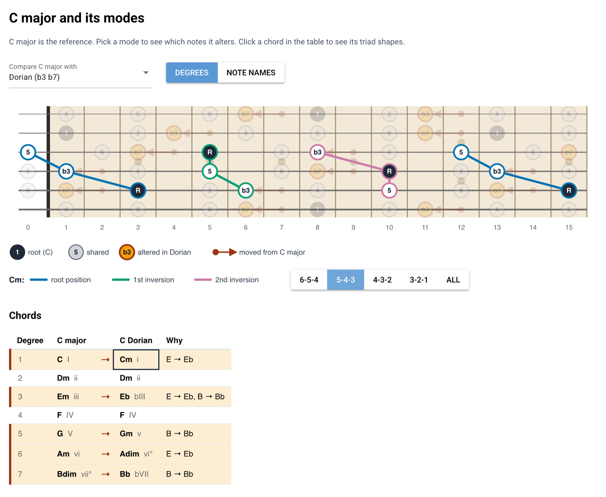

# Fretboard scale visualiser

A small web app for learning the guitar fretboard the way the modes are built: learn the
**C major scale** first, then learn every other C mode as a few **alterations** of it.
C major is always the reference. Pick a mode and the fretboard shows exactly which notes
move, a table shows which chords change, and a click on a chord shows where to play its
inversions.

Built with Python and [NiceGUI](https://nicegui.io).



*C Dorian against C major. The b3 and b7 arrows show which notes move, the table shows
which chords change, and the selected Cm chord is drawn as triad shapes on strings 5-4-3.*

## Features

- **Mode comparison on the fretboard.** C major is overlaid with the selected C mode. Notes
  both scales share stay grey, each altered note is highlighted, and an arrow slides from the
  C major note to its replacement.
- **Chord table.** The triad on every scale degree, with chord name and Roman numeral, side by
  side for C major and the mode. Changed chords are highlighted, with the altered notes that
  cause each change.
- **Triad inversions.** Click a chord to see every compact three-string shape of it, coloured
  by inversion and connected by lines, on one string set or on all of them.
- **Degree or note-name labels**, spelled from the degree (`b3` = Eb, `#4` = F#).

## Quick start

Requires Python 3.12 or newer.

```bash
python3 -m venv .venv
.venv/bin/pip install -e ".[dev]"
.venv/bin/python -m fretboard.app
```

Then open <http://localhost:8080>.

## Using the app

### 1. Pick a comparison

| Option                  | Alterations of C major |
|-------------------------|------------------------|
| C major alone           | none                   |
| Lydian                  | #4                     |
| Mixolydian              | b7                     |
| Dorian                  | b3 b7                  |
| Aeolian / natural minor | b3 b6 b7               |
| Phrygian                | b2 b3 b6 b7            |
| Locrian                 | b2 b3 b5 b6 b7         |

The modes are listed from brightest to darkest. From one mode to the next, one more note
changes, which makes it a natural order to learn them in.

### 2. Read the fretboard

Standard tuning, frets 0-15, high E string on top. Use the toggle to label dots with scale
degrees (default) or note names.

- **Dark dot**: the root, C.
- **Grey dot**: a note in both C major and the selected mode.
- **Orange dot with a thick outline**: the mode's altered note.
- **Arrow**: a C major note that the mode moves. The small dot marks where the C major note
  was. The arrow slides along the string to the altered note, one fret towards the nut for a
  `b` and one fret away from it for a `#`. Near the nut, where a flat would fall below fret 0,
  no arrow is drawn; the same degree appears elsewhere on the neck.

### 3. See how the chords change

Below the fretboard, the chord table lists the triad on each degree with its name and Roman
numeral (for example `Dm ii`). With a mode selected, it adds the mode's triads next to the
C major ones. Rows where the chord changes are highlighted and show an arrow. The "Why"
column names the altered notes in that chord:

| Degree | C major  |   | C Dorian  | Why             |
|--------|----------|---|-----------|-----------------|
| 1      | C I      | → | Cm i      | E → Eb          |
| 2      | Dm ii    |   | Dm ii     |                 |
| 3      | Em iii   | → | Eb bIII   | E → Eb, B → Bb  |

Chords are always named by note, so the table ignores the degrees/note-names toggle.

### 4. Find the chord on the neck

Click a chord in the table (C major column or mode column). The scale fades into the
background and every compact shape of that triad is drawn on top: three notes on three
neighbouring strings, within one octave, at most five frets wide (open strings don't count).

- **Blue**: root position (root in the bass)
- **Green**: 1st inversion (3rd in the bass)
- **Purple**: 2nd inversion (5th in the bass)

Dots are labelled with chord tones (`R`, `3`/`b3`, `5`/`b5`). Pick the string set with the
toggle next to the legend: 6-5-4, 5-4-3, 4-3-2, 3-2-1 (default) or all. With "all", a note
shared by shapes of different inversions gets a grey outline. Click the chord again to clear
it. The selection keeps its degree and column when you switch modes, so you can compare, for
example, the chord on degree 3 across all modes.

## Development

Run the tests:

```bash
.venv/bin/pytest
```

The tests cover the music theory, the rendered SVG and HTML (through data attributes on dots,
arrows, shapes and table cells), and the page itself through NiceGUI's user simulation.

### Project structure

```
fretboard/
  theory.py   modes as alterations of major, note classification and spelling,
              diatonic triads, triad shapes (voicings) on the fretboard
  render.py   SVG fretboard, legends and triad shapes; HTML chord table
  app.py      NiceGUI page: controls, state and event wiring
tests/        pytest suite, one file per area
openspec/     specifications and the history of changes
```

`theory.py` and `render.py` do not import NiceGUI, so they can be tested without a browser.
`app.py` only connects the controls to the renderers.

### Specifications

The app is developed spec-first with [OpenSpec](https://github.com/Fission-AI/OpenSpec). The
current behaviour is described in `openspec/specs/`:

| Spec                | Covers                                                    |
|---------------------|-----------------------------------------------------------|
| `fretboard-display` | neck layout, markers, note dots, labels, legend           |
| `mode-comparison`   | C major reference, mode options, shared/altered/arrows    |
| `chord-table`       | diatonic triads, changed chords, why column, selection    |
| `triad-inversions`  | playable shapes, inversions, string sets, overlay drawing |

Each completed change, with its proposal, design and tasks, is kept in
`openspec/changes/archive/`.

## Ideas for later

- CAGED system
- Other tunings (drop D, DADGAD, 7-string, bass)
- More scales (harmonic and melodic minor, pentatonics, blues)
- Roots other than C
